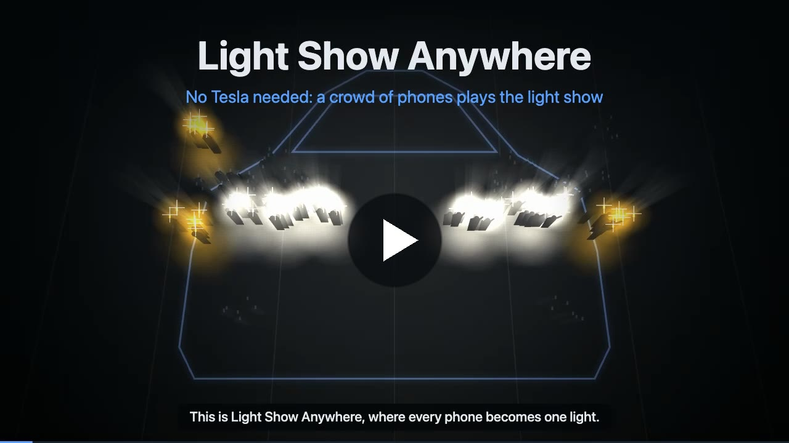
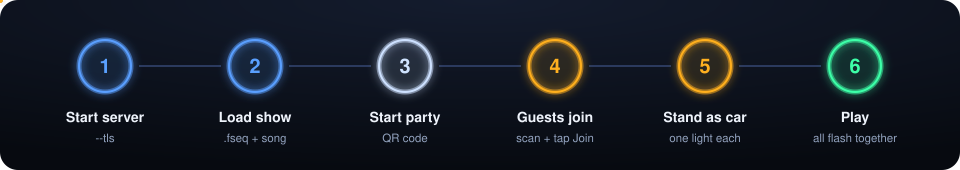
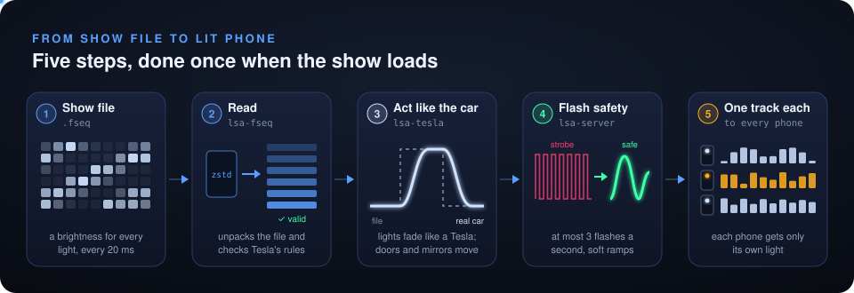

<div align="center">

# 💡 Light Show Anywhere

**Turn a crowd of phones into a Tesla light show.**

Every phone becomes one light of the car, and all of them flash together with the music.<br>
No app to install and no Tesla needed: guests just scan a QR code.


<a href="docs/media/demo.mp4"></a>

▶ **[Watch the demo video](docs/media/demo.mp4)** (68 s, with narration and music)

</div>

---

## 📑 Contents

- [What it does](#-what-it-does)
- [Features](#-features)
- [Quick start](#-quick-start)
- [Host a party](#-host-a-party)
- [How it works](#-how-it-works)
- [Project structure](#-project-structure)
- [Development](#-development)
- [Demo video](#-demo-video)

---

## ✨ What it does

Tesla cars can play light shows: a song, plus a file (`.fseq`) that says which light is on at
every moment. **Light Show Anywhere plays those shows on people instead of a car.**

| 1. Load | 2. Join | 3. Play |
|:---:|:---:|:---:|
| The host opens a show and its song on a laptop. | Guests scan the QR code. Each phone gets one light: left headlight, right turn signal… | Everyone stands in the shape of a car and lifts their phone. The crowd lights up like the car. |

---

## 🚀 Features

| | Feature | What it means |
|---|---|---|
| 🚗 | **Car preview** | Watch any show on an animated Model S, Model X, Model 3/Y or Cybertruck before the party. |
| 📱 | **Phone party** | Phones join from the browser. Each gets its own light and plays it with screen and flashlight. |
| ⏱️ | **Clock sync** | Every phone follows the server's clock, so they all flash together (within a few hundredths of a second). |
| 🛡️ | **Flash safety** | Fast strobes are slowed to at most 3 flashes a second, safe for people with photosensitive epilepsy. |
| 🔊 | **Speaker delay** | Phones can listen to the speaker and measure its delay, so Bluetooth speakers stay in time. |
| 🔷 | **Crowd layouts** | Use a grid, line or circle of up to 4096 places instead of the car shape. |
| 🚙 | **Fleet shows** | Tesla's multi-car shows split the phones across several cars. |
| 🌈 | **LED strips** | [WLED](https://kno.wled.ge) strips can join as extra lights. |
| 🎬 | **Video export** | Save the preview with its song as an MP4. |
| 📶 | **Handles dropouts** | A phone that loses Wi-Fi keeps playing and gets its light back. If the host reloads, the party goes on. |

---

## ⚡ Quick start

### Requirements

- [Rust](https://rustup.rs) (the right version installs itself from `rust-toolchain.toml`)
- [Node.js 24](https://nodejs.org) and [wasm-pack](https://rustwasm.github.io/wasm-pack/)

### Watch a show on your computer

```bash
git clone https://github.com/Rizu0007/light-show-anywhere.git
cd light-show-anywhere/web
npm install
npm run dev                 # opens http://localhost:5173
```

Drop a `.fseq` show and its `.wav` or `.mp3` song onto the page, then press **Play**.

> **No show yet?** Run `scripts/fetch-tesla-example.sh` to download Tesla's example into `shows/`.

| Key | Action |
|---|---|
| `Space` | Play / pause |
| `←` `→` | Jump 5 seconds |
| `Home` | Back to the start |

---

## 🎉 Host a party

Phones only turn on the flashlight and keep the screen awake on **HTTPS** pages, so start the
server with `--tls`. It makes its own certificate.

```bash
(cd web && npm install && npm run build)
cargo run --release -p lsa-server -- --tls --static web/dist    # app + party server on port 8787
```

<p align="center"></p>

1. On the host computer, open the **https://** address the server prints (for example
   `https://192.168.1.20:8787`), not `localhost`. Accept the certificate warning once.
2. Load a show and its song, then press **Start party**.
3. Guests on the **same Wi-Fi** scan the QR code and tap **Join the show**. Each phone warns
   about the certificate once (Chrome: *Advanced → Proceed*; Safari: *Show Details → visit this
   website*).
4. Each phone shows its light. Place people where that light is on the car.
5. Press **Play**. The **Phones** list warns about any phone that won't play well.

<details>
<summary><b>More options</b> (speaker delay, crowd layouts, fleet shows, LED strips, limits)</summary>

<br>

| Option | How to use it |
|---|---|
| **Speaker delay** | If the sound comes after the lights, set **Speaker delay**, or press **Measure speaker delay**. Guests who tick *Help tune the sound* listen to five short tones. Measure with the show paused. |
| **Crowd layout** | Make a grid, line or circle of places. Drag places to move them, double-click to add one, press Delete to remove one. **Use the car shape** goes back. |
| **Fleet show** | Load the show's folder with **Fleet show (folder)**. Each phone shows its car number; group guests by car, numbered left to right as seen from the front. |
| **LED strips** | List WLED devices in a file and start with `--wled wled.json` (see [`docs/wled.example.json`](docs/wled.example.json)). |
| **Your own certificate** | Use `--cert cert.pem --key key.pem` instead of `--tls`. |
| **Limits** | One server holds 64 parties and serves 2000 phones. The Wi-Fi router is usually the real limit, so use access points made for crowds. |

</details>

---

## 🧠 How it works

<p align="center"></p>

<p align="center"></p>

<p align="center"></p>

1. **Read:** the `.fseq` file is a table of brightness values, one row every 20 ms and one
   column per light.
2. **Act like the car:** the engine copies how a Tesla behaves: lights fade in and out, and
   doors and mirrors move.
3. **Give out lights:** each new phone gets the light with the fewest phones on it, so headlights
   fill first.
4. **Send tracks:** each phone gets only its own light's track, with fast flashes slowed down.
5. **Play together:** Play starts 1 second in the future on the server's clock. Every phone knows
   that clock, so they all start at the same moment.

---

## 📁 Project structure

```
light-show-anywhere/
├── crates/
│   ├── lsa-fseq/      Reads and writes .fseq show files, checks Tesla's rules
│   ├── lsa-tesla/     Tesla light map and car emulation (fades, doors, mirrors)
│   ├── lsa-wasm/      The engine compiled to WebAssembly for the browser
│   └── lsa-server/    Party server: rooms, clock sync, lights, safety, WLED, HTTPS
├── web/               React app: car preview, host page, phone page, video export
│   ├── src/
│   └── scripts/       Browser tests and the demo video scripts
├── docs/              Development guide, demo video playbook, WLED example
└── scripts/           Downloads Tesla's example show
```

| Part | Built with |
|---|---|
| Engine | Rust, compiled to WebAssembly |
| Server | Rust, axum, WebSockets |
| App | React, TypeScript, Vite |
| Video export | Mediabunny |

---

## 🛠️ Development

```bash
cargo test --workspace --all-features   # Rust tests
cd web && scripts/e2e.sh                # browser tests with headless-Chrome phones
```

Hot reload, every test, the 2000-phone load test and more: **[docs/development.md](docs/development.md)**.

---

## 🎬 Demo video

**[Watch it here](docs/media/demo.mp4)**: a 68-second narrated video showing how to use the app
and how it works, with a night scene of a crowd lighting up together. It is made entirely in code.
To build it again, see [docs/development.md](docs/development.md#demo-video); the video is saved
to `media/light-show-anywhere-demo.mp4`, with a square copy for social feeds next to it
(`…-demo-square.mp4`); copy the first to `docs/media/demo.mp4` to update the README's.

Want the same kind of video for another project? Follow
**[docs/demo-video-playbook.md](docs/demo-video-playbook.md)**.

---

<div align="center">

Third-party code and licenses: see [NOTICE](NOTICE).

</div>
